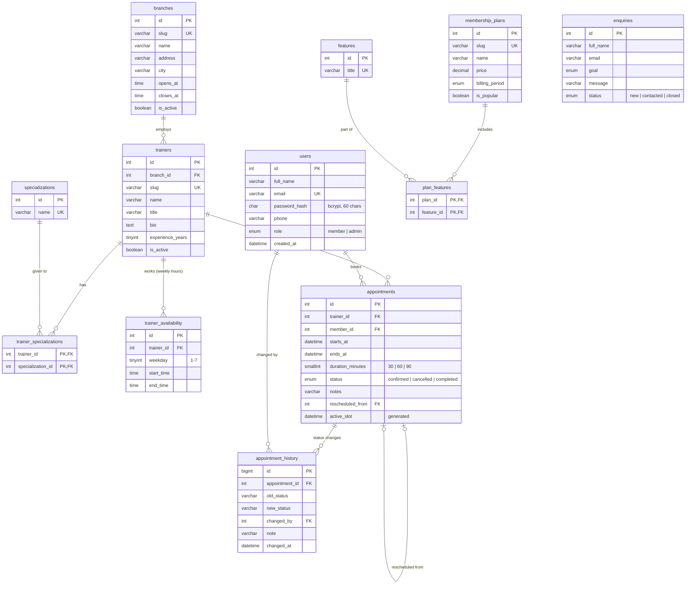

# Database design

MySQL 8, InnoDB. The whole schema is in [`database/schema.sql`](../database/schema.sql).

## ER diagram



## Constraints and why each one exists

| Table | Constraint | Why |
|---|---|---|
| `users` | `UNIQUE (email)` | One account per email. Register answers 409 on a duplicate |
| `users` | `CHECK (CHAR_LENGTH(TRIM(full_name)) >= 2)` | No blank names, even if the API had a bug |
| `branches` | `CHECK (opens_at < closes_at)` | A branch cannot close before it opens |
| `trainers` | `FOREIGN KEY (branch_id)` | Every trainer belongs to a real branch |
| `trainer_availability` | `UNIQUE (trainer_id, weekday)`, `CHECK (weekday BETWEEN 1 AND 7)`, `CHECK (start_time < end_time)` | One working window per day, valid days and times |
| `membership_plans` | `CHECK (price >= 0)` | No negative prices |
| `appointments` | `CHECK (duration_minutes IN (30, 60, 90))` | Only the session lengths we sell |
| `appointments` | `CHECK (ends_at = starts_at + INTERVAL duration_minutes MINUTE)` | The end time can never disagree with the duration |
| `appointments` | **`UNIQUE (trainer_id, active_slot)`** | Safety net for the hard requirement: two confirmed bookings of one trainer at the same start time are impossible. `active_slot` is `starts_at` while confirmed and `NULL` otherwise, and `UNIQUE` allows many `NULL`s, so cancelled rows don't block the slot |
| `appointments` | `FOREIGN KEY (rescheduled_from)` | Links a rescheduled booking to the one it replaced |
| `appointment_history` | Triggers `trg_history_no_update`, `trg_history_no_delete` | Append-only: the past can never be rewritten |

Things the database cannot express on its own (overlapping *ranges*, working hours) are checked by the
API **inside the locked transaction** (`backend/utils/schedule.js`, `assertBookable`).

## Normalisation

- **1NF:** every column holds one value. A trainer's specialisations are rows in `trainer_specializations`,
  not a comma-separated column.
- **2NF / 3NF:** every non-key column depends only on its table's key. Branch details live only in
  `branches`; an appointment stores `trainer_id`, and the branch is found through the trainer.
- **History is not duplicated state:** `appointments.status` is the current status;
  `appointment_history` is the log of how it got there.

## Transactions and locking

| Operation | Rows changed together | Locks |
|---|---|---|
| Book | `appointments` + `appointment_history` | trainer row, then member row (`FOR UPDATE`) |
| Reschedule | old appointment → cancelled, new appointment inserted, 2 history rows | trainer, then member |
| Cancel / complete | `appointments` + `appointment_history` | conditional `UPDATE ... WHERE status = 'confirmed'` |
| Create / edit trainer | `trainers` + `trainer_specializations` (+ `trainer_availability` on create) | none needed |

- Isolation level **READ COMMITTED** (`backend/utils/transaction.js`): once a request gets the trainer lock,
  its `SELECT`s see the booking the previous lock holder just committed.
- Locks are always taken in the same order (**trainer, then member**), so two bookings can never wait for
  each other in a circle, which means no deadlocks.

## Volume and indexes

`npm run db:setup` creates about **5,500 appointments** and **11,000 history rows** for 300 members.

| Query (where it runs) | Index used | `EXPLAIN` result |
|---|---|---|
| Overlap check while booking: `WHERE trainer_id = ? AND status = 'confirmed' AND starts_at < ? AND ends_at > ?` | `idx_appointments_status_time` / `idx_appointments_trainer_time` | `range`, ~12 rows examined instead of 5,500 |
| My sessions: `WHERE member_id = ? ORDER BY starts_at DESC LIMIT 20` | `idx_appointments_member_time` | `ref`, ~18 rows, no filesort (backward index scan) |
| Admin list: `WHERE status = ? ORDER BY starts_at DESC LIMIT 20 OFFSET 40` | `idx_appointments_status_time` | `ref`, no filesort, so the sort comes free from the index |

To see it yourself in MySQL Workbench:

```sql
USE fitlean;
EXPLAIN SELECT * FROM appointments WHERE member_id = 50 ORDER BY starts_at DESC LIMIT 20;
```

Without the index the same query reads every row and then sorts them. Compare:

```sql
EXPLAIN SELECT * FROM appointments IGNORE INDEX (idx_appointments_member_time)
WHERE member_id = 50 ORDER BY starts_at DESC LIMIT 20;
-- type = ALL, rows ≈ 5,850, Extra = "Using where; Using filesort"
```
